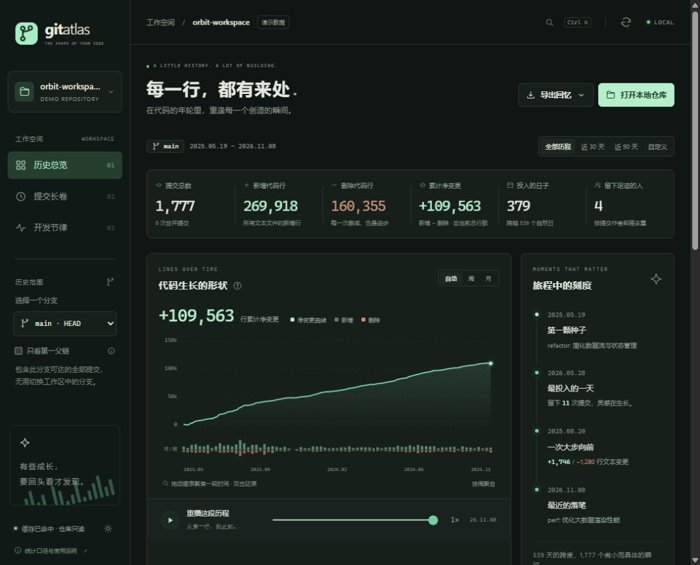

# Git Atlas · 每一行，都有来处

一个纯本地、只读的 Git 开发历程可视化应用。选择仓库根目录、`.git` 目录或 worktree 的 `.git` 文件，回顾代码的增删、时间的分布和每一次提交。



[活动日历与贡献分布预览](docs/details.jpg)

## 启动

需要 **Python 3.10+** 和 **Git 2.45+**，均须在 PATH 中。没有需要安装的 Python 或前端依赖，运行时无需联网。

Windows 双击 `start.cmd`，或在本目录运行：

```powershell
python app.py
```

默认在 `http://127.0.0.1:8765` 启动并打开浏览器。如果端口被占用，会尝试后续端口；以终端实际输出为准。按 `Ctrl+C` 退出。

也可以直接指定仓库：

```powershell
python app.py --repo "D:\projects\my-project\.git"
python app.py --repo "D:\projects\my-project" --port 9000 --no-browser
```

macOS / Linux 使用 `sh start.sh` 或 `python3 app.py`。系统文件夹选择器依赖可选的 Tkinter；不可用时直接粘贴路径即可。

## 可以回顾什么

- **单分支浏览**：默认当前分支，包含其可达的完整祖先历史；可切换“只看第一父链”。不执行 checkout。
- **所有分支**：本地分支、远程跟踪分支和 HEAD 的可达提交并集，按提交 ID 去重。
- **历史总览**：提交数、文本新增 / 删除 / 累计净变更、活跃天数、作者数、里程碑、活动日历、语言变更分布。
- **生长曲线**：按日 / 周 / 月自适应聚合，可拖动图表选中日期范围，双击还原。
- **历程回放**：播放、暂停、拖动进度、1× / 2× / 4× 速度。回放只影响曲线，顶部统计仍表示完整的当前筛选范围。
- **提交长卷**：说明、作者、邮箱和 hash 搜索；作者筛选；正序 / 倒序；每页 60 条；点击查看完整提交说明与文件增删。
- **开发节律**：星期 × 小时热力图、周分布、月度提交量、最长连续与最长留白。
- **交互筛选**：日期、作者和关键词同时生效；点击活动日历跳转当天提交；点击月份聚焦该月。
- **导出回忆**：当前筛选的独立离线 HTML 可视化报告，或包含全部筛选提交的 UTF-8 CSV。演示数据会明确标注。
- **明暗主题**、响应式布局、最近打开的仓库、`Ctrl / ⌘ K` 搜索、`Esc` 关闭弹窗。

## 数字的含义

1. 新增与删除取自 Git `numstat`，统计所有被提交的文本文件，包含代码、文档、配置、锁文件和生成文件。二进制文件不计文本行，只记文件触达次数。按文件扩展名分类的“语言”表示**历史变更分布**，不是当前代码构成。
2. **累计净变更 = 新增 − 删除，不等于当前代码总行数。** 完整历史模式下，合并提交保留记录，但不累加其文件增删，避免重复计入合入的提交；因此也不会计入只发生在合并中的冲突解决行数。
3. 第一父链模式只沿第一父提交回溯，包含合并相对第一父提交的变更；所有分支模式使用完整历史。
4. 为兼顾速度、稳定性和文件名正确性，关闭重命名检测。重命名会表现为旧文件删除、新文件新增，累计净值不受纯重命名影响，但增删量会增加。
5. 使用 **Git 作者日期与其原始时区**。不同作者的日期可能来自不同的时区。连续天数根据这些日期计算；提交数无法推导真实工作时长。近 30 / 90 天以浏览器的今天为基准。
6. 浅克隆只包含本地已有历史；未提交修改、仅由标签 / stash 引用的历史，以及已经不可达的提交不在统计中。所有分支包括远程跟踪分支，不主动 fetch。

参考：[Git log 文档](https://git-scm.com/docs/git-log)、[Git rev-parse 文档](https://git-scm.com/docs/git-rev-parse)。

## 性能与本地数据

服务使用 Python 标准库与本机 Git。一次 Git 流式历史扫描同时读取提交元数据和文件行变更，分批写入 SQLite；建立日期、时间、作者索引后执行聚合。浏览器只接收聚合数据和当前一页的提交，不一次加载全部历史，也不逐条启动 Git 进程。文件详情按需读取。

应用目录下的 `.cache/` 保存 SQLite 历史缓存与最近路径。缓存按仓库、分支、第一父链模式和引用快照区分；分支有新提交时自动失效。刷新按钮重新读取分支并强制重建当前视图。不同分支首次打开各需扫描一次；之后复用各自缓存。缓存不会写入被查看的仓库。关闭应用后可删除 `.cache/` 以清空历史缓存和最近路径。

服务仅绑定 `127.0.0.1`，本地 API 验证会话令牌和 Host。不使用 CDN、遥测或外部 API，不上传仓库。读取时禁用外部 diff、textconv、fsmonitor、可选 Git 写锁与部分克隆的自动抓取；缺失对象会返回读取错误。

## 验证

```powershell
python -m unittest discover -s tests -v
node --check static/app.js
```

测试会在临时目录创建真实 Git 仓库，验证分支并集去重、合并口径、第一父链、日期与搜索过滤、分页、二进制和中文路径、重命名、空仓库、裸仓库、worktree、缓存失效、API 会话限制及 CSV 公式转义。不会访问用户已有仓库。

可选性能测试：`python tests/benchmark.py --commits 100000`。它在临时仓库中生成真实提交，再执行完整 Git 读取和统计。在本次 Windows 环境中，100,000 条单行文件变更提交的首次扫描为 **11.1 秒**，统计聚合为 **0.57 秒**，中间页读取为 **16 毫秒**；SQLite 缓存约 **46.5 MB**，聚合响应约 **304 KB**。不同仓库的文件数量、提交体积、磁盘和 Git 对象压缩程度会影响耗时；此结果不代表复杂仓库的速度保证。重复筛选还有进程内聚合结果缓存。

本次验证的完整范围和环境限制见 [验证记录](docs/validation.md)。

## 文件

```text
app.py              本地 HTTP API、Git 流式读取、SQLite 缓存与聚合
picker.py           可选的系统文件夹选择器
static/index.html   应用界面
static/style.css    明暗主题与响应式布局
static/app.js       Canvas 图表、回放、筛选、提交浏览与离线导出
tests/test_app.py    真实 Git 集成测试
start.cmd / start.sh 启动入口
```
